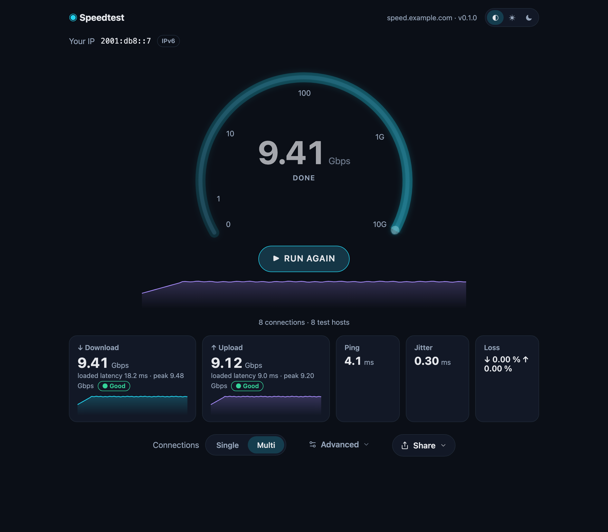
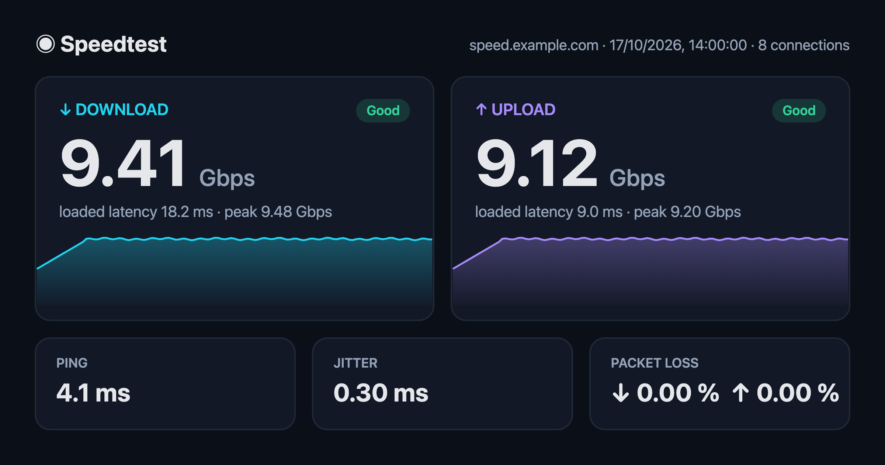

# Firehose

A self-hosted network speed test built for **10 Gbps**. One Go binary serves the
web UI and includes a CLI client for scripted tests and measuring past browser limits.



Example PNG exported from **Share → Image**:



- Download and upload with single or multiple connections (default 8, up to 32).
- Idle and loaded latency, jitter, and WebRTC packet loss.
- Share results as an image, text, or JSON.
- CLI with human, JSON, and CSV output, plus repeat runs for monitoring.
- One static binary, an embedded UI, and a small container image.

## Quick start

```bash
docker build -t firehose:local .
docker run --rm -p 127.0.0.1:8080:8080 -p 50000:50000/udp firehose:local serve --dev
```

Open <http://localhost:8080>. `--dev` disables authentication for local testing.

For production, omit `--dev`, set `FIREHOSE_PUBLIC_URL`, and put the server behind
an HTTPS reverse proxy that authenticates users and sets the header configured by
`FIREHOSE_AUTH_HEADER` (default `Remote-User`). Use your preferred proxy and
authentication provider.
Forward UDP 50000 directly to the container for packet-loss tests.

## Browser performance

**Chrome/Brave can download faster, while Firefox can upload faster.** We observed
this in macOS localhost tests with Brave (Chromium) and Firefox Nightly. Results
vary with browser version, hardware, and settings.

At multi-gigabit speeds, browser buffering, memory copies, and JavaScript delivery
can limit throughput before the network does. More connections can add overhead
and reduce speed when the browser or CPU is saturated. Firehose limits browser
download responses to 64 MiB to reduce Firefox buffering stalls and reuses
immutable Blobs for uploads.

Keep the test tab in the foreground and compare browsers with the same settings.
Loaded latency includes browser scheduling delays, so high localhost latency alone
does not indicate router bufferbloat. Compare with `firehose client` to help
separate browser limits from server or network limits.

## Deployment

The container listens on `0.0.0.0:8080`. Key environment variables:

| Variable | Purpose |
|---|---|
| `FIREHOSE_PUBLIC_URL` | Public UI origin, e.g. `https://speed.example.com` |
| `FIREHOSE_TEST_HOSTS` | Comma-separated test origins to get past the browser's 6-connections-per-host limit |
| `FIREHOSE_AUTH_HEADER` | Header set by your authentication proxy (default `Remote-User`) |
| `FIREHOSE_API_TOKEN` | Bearer token for CLI access; empty disables bearer access |
| `FIREHOSE_TRUSTED_PROXIES` | Proxy CIDRs whose `X-Forwarded-For` is trusted |
| `FIREHOSE_RTC_PUBLIC_IPS` | Public IPs to advertise for WebRTC when behind NAT |

Use **HTTP/1.1 on browser-facing test hosts** so parallel streams use separate TCP
connections. Disable HTTP/3, response compression, and buffering on test routes,
and allow WebSocket upgrades.

Configure the proxy's browser-facing TLS listener to advertise only HTTP/1.1
through ALPN for the test hostnames. Changing only the upstream protocol does
not force browsers to use HTTP/1.1.

Run `firehose serve --help` for all server options. Environment variables have
matching flags, e.g. `FIREHOSE_LISTEN` / `--listen`; flags take precedence.

## CLI

Download a binary from [Releases](https://github.com/CicerBro/firehose/releases),
or use the container image:

```bash
docker run --rm -e FIREHOSE_TOKEN ghcr.io/cicerbro/firehose client --server https://speed.example.com
```

Set `FIREHOSE_TOKEN` to the server's `FIREHOSE_API_TOKEN` for authenticated access.
With a local binary:

```bash
export FIREHOSE_SERVER=https://speed.example.com
export FIREHOSE_TOKEN=…
firehose client                             # full test
firehose client -n 1                         # single connection
firehose client -n 16 -d 20s                 # 16 streams, 20 seconds per direction
firehose client --json                      # same result schema as the browser
firehose client --interval 1h --format csv --csv-header -q >> speed.csv
firehose client --help                      # all options
```

## Development

Requires Go ≥ 1.25, [Bun](https://bun.sh) ≥ 1.4, and `make`.

```bash
make dev       # Go server on :8080 + Vite on :5173
make build     # build UI and embed it in ./firehose
make test      # Go race tests + Bun tests
make lint      # go vet, staticcheck, TypeScript
make e2e       # Playwright: Chromium, Firefox, WebKit
```

Build with `make build` to include the UI; plain `go build` does not build it.
